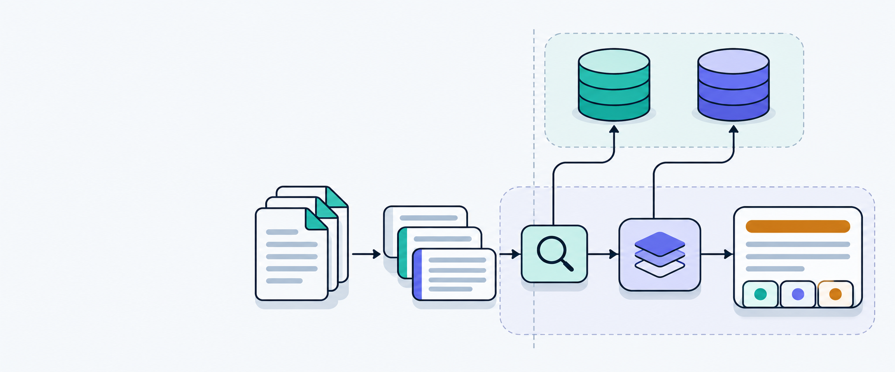
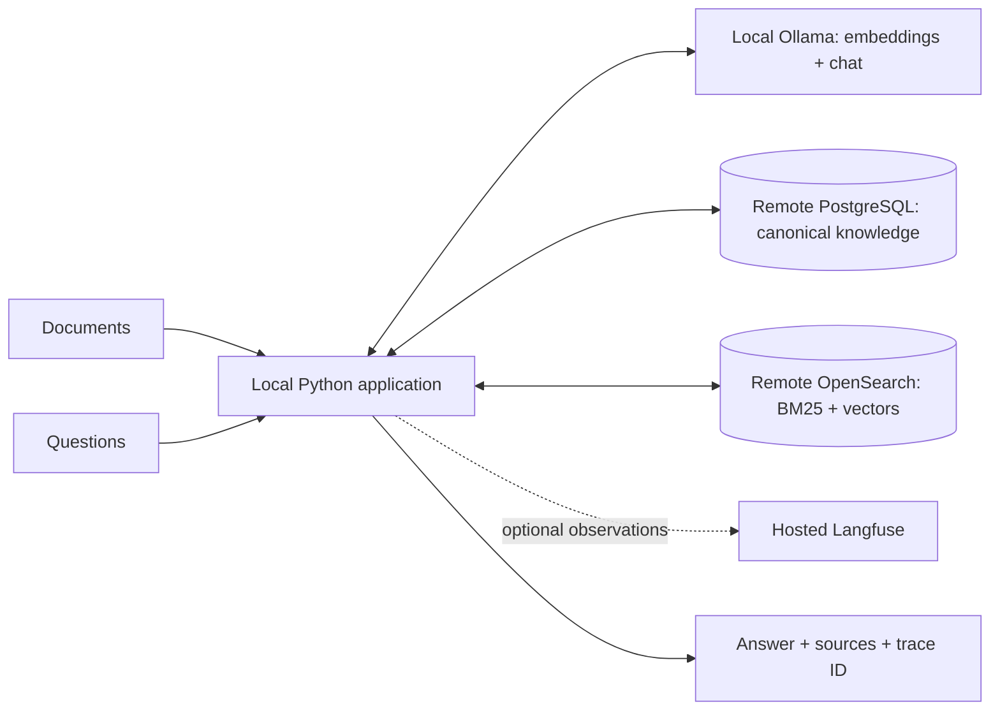

# RAG Lab

### From documents to answers you can verify.



Learn Retrieval-Augmented Generation through a small, explicit implementation: **remote PostgreSQL and OpenSearch, local Ollama, and optional hosted Langfuse**. Follow the data from ingestion to evidence, compare three retrieval strategies, and inspect every model call.

[Start the project](docs/getting-started.md) ? [Open the notebook](notebooks/rag_walkthrough.ipynb) ? [Read the docs](docs/README.md) ? [Explore the code](src/rag_lab)

---

## What you will build

A document assistant that loads text, Markdown, PDFs, or an arXiv paper; retrieves useful passages; and asks a local model to answer with numbered evidence. An optional adaptive workflow grades relevance and retries retrieval once. Langfuse connects the stages in a trace you can inspect.

| Learn | Implement | Inspect |
| --- | --- | --- |
| Knowledge ingestion | Deterministic chunking and local embeddings | Document revisions and chunk boundaries |
| Retrieval | BM25, vector search, and reciprocal rank fusion | Ranked excerpts and retrieval metrics |
| Grounded generation | Bounded context and local Ollama chat | Answers alongside the evidence supplied |
| Adaptive retrieval | Grade ? rewrite ? retrieve, with a two-attempt bound | Workflow actions and abstention |
| Observability | Nested Langfuse observations | Timing, model usage, counts, and errors |

## What runs where



PostgreSQL owns the canonical text and active chunks. OpenSearch is a rebuildable search index. Ollama computes embeddings and answers locally. Text and vectors still travel to your remote storage services; optional Langfuse content capture sends prompts and excerpts to its configured host.

**The project needs no Docker, Airflow, Redis, Jina API, or paid model API.** It connects to your existing PostgreSQL and OpenSearch services. See [the architecture](docs/architecture.md) for separate ingestion and question flows.

## Get started

Requires Python 3.11+, uv, reachable remote storage, and a local Ollama server. Run these commands from the project root in PowerShell:

```powershell
uv sync --extra dev
if (!(Test-Path .env)) { Copy-Item .env.example .env }
notepad .env

ollama pull nomic-embed-text
ollama pull llama3.2:3b

uv run rag init
uv run rag doctor
uv run rag ingest data/sample
uv run rag ask "Who approves a production restore?"
```

Set your remote connection values in `.env` before initializing. Start `ollama serve` if the Ollama application is not already serving. Keep existing credentials when returning to the project.

> **Initialize first:** `UndefinedTable` from PostgreSQL and a missing-index HTTP 404 from OpenSearch can mean the application tables and index have not been created. Run `rag init`, then `rag doctor`.

Follow [the setup guide](docs/getting-started.md) for prerequisites, TLS configuration, checkpoints, and expected results.

## Learn in a notebook

```powershell
uv sync --extra dev --extra notebook
uv run --extra notebook jupyter lab notebooks/rag_walkthrough.ipynb
```

The [guided notebook](notebooks/rag_walkthrough.ipynb) starts in **offline mode**: inspect sample documents, experiment with chunking, calculate rank fusion, and build a bounded evidence context without credentials. Its live mode uses this project's actual clients to ingest, search, generate, evaluate, and inspect trace IDs.

[Notebook instructions](notebooks/README.md) explain the execution switches. A generated [HTML preview](notebooks/rag_walkthrough.html) lets you read the offline walkthrough without launching Jupyter.

## Run the API

```powershell
uv run uvicorn rag_lab.api:app --host 127.0.0.1 --port 8000
```

Open `http://127.0.0.1:8000/docs`. The API exposes health checks, document listing, search, and answers. It has no authentication or tenant isolation; retain the local loopback binding. See [the API reference](docs/api.md) for requests and response fields.

## Enable Langfuse tracing

Use Langfuse Cloud or an existing compatible hosted instance. Add your project keys and base URL to `.env`, then set `LANGFUSE_ENABLED=true`. Restart long-lived clients and run `uv run rag doctor`.

The integration covers ingestion, retrieval, model calls, context, and storage. Text capture is off by default; timing, usage, IDs, scores, and error types are still recorded when tracing is active. See [the setup and trace walkthrough](docs/observability.md) for configuration, compatibility, and delivery checks.

## The learning library

| Guide | Focus |
| --- | --- |
| [Documentation home](docs/README.md) | Choose a path through the project |
| [Implementation walkthrough](docs/implementation.md) | Read the pipeline with the responsible source modules |
| [Hands-on lessons](docs/lessons.md) | Eight focused experiments with checkpoints |
| [Configuration](docs/configuration.md) | All environment settings and model identity rules |
| [Operations](docs/operations.md) | Initialization, recovery, migrations, and troubleshooting |

## Validate your work

```powershell
uv run ruff check .
uv run pytest
uv run --extra notebook python scripts/check_notebook.py
```

Unit tests use fake remote dependencies; tracing tests use the actual SDK with an in-memory exporter. The notebook check executes its offline path and refreshes the HTML preview. For a small service-backed retrieval exercise, ingest the sample corpus and run `uv run python scripts/evaluate.py --mode hybrid`.

## Scope and provenance

This is a single-user learning project. Questions are stateless, responses are complete JSON, and ingestion is an explicit CLI operation. Scanned PDFs need external OCR. Generated citations need human verification; model grading can be wrong. See [architecture and limits](docs/architecture.md#scope) for the implementation's practical boundaries.

The project follows the learning progression of [jamwithai/production-agentic-rag-course](https://github.com/jamwithai/production-agentic-rag-course), with an independent implementation adapted to remote storage and local inference. The sample corpus describes the fictional company Northstar.
