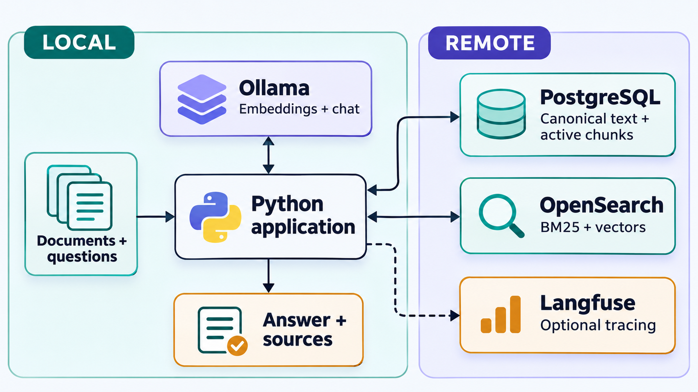
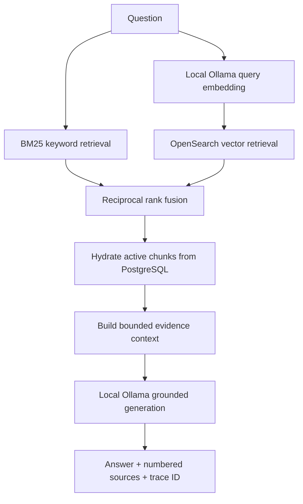

# Architecture

**Local inference. Remote storage. Evidence you can inspect.**

[Documentation](README.md) · [Implementation](implementation.md) · [Configuration](configuration.md)

## Service boundaries

*Python coordinates local Ollama inference with remote canonical storage, search, and optional hosted tracing.*

| Location | Component | Owns or computes |
| --- | --- | --- |
| Your computer | Python CLI, FastAPI, notebook | The application workflow |
| Your computer | Ollama embedding model | Vectors for documents and questions |
| Your computer | Ollama chat model | Grounded generation, optional grading and rewriting |
| Remote | PostgreSQL | Original extracted text, document metadata, active chunks |
| Remote | OpenSearch | A rebuildable BM25 and vector search index |
| Hosted, optional | Langfuse | Observations, trace hierarchy, timing, model usage |

Ollama inference stays local. Document text and embeddings still travel to the configured remote storage services. Optional Langfuse text capture sends prompts and excerpts to its configured host.

## Path A · Ingest knowledge

The order is deliberate. Versioned search records are written first; canonical SQL rows change only after indexing succeeds. Search results must resolve to active SQL chunks, so unfinished search records cannot become returned evidence. A per-document PostgreSQL advisory lock serializes ingestion and cleanup for that document.

There is no transaction spanning both remote systems. Orphan index records can consume search candidate slots until cleanup or reindexing succeeds. This design protects which revision is visible, while allowing temporary reductions in retrieval recall.

## Path B · Answer a question

This diagram shows hybrid mode. Keyword mode uses the BM25 branch; semantic mode uses the vector branch. The same embedding configuration must be used at indexing and query time.

In agentic mode, the pipeline grades retrieved excerpts. If none are useful, it rewrites the query once, retrieves again, and grades against the original question. The workflow ends in generation or abstention after at most two retrieval attempts.

## Where observability fits

Each ingestion or question starts its own trace. Child spans cover loading, chunking, model calls, search, SQL operations, context, and cleanup. Tracing uses the same client throughout an operation and drains buffered events during service shutdown. See [the full trace trees](observability.md).

## Follow the code

| Stage | Module | Key entry point |
| --- | --- | --- |
| Load | [`loaders.py`](../src/rag_lab/loaders.py) | `load_file`, `load_arxiv` |
| Split | [`chunking.py`](../src/rag_lab/chunking.py) | `chunk_text` |
| Embed / generate | [`ollama.py`](../src/rag_lab/ollama.py) | `Ollama.embed`, `Ollama.chat` |
| Store / hydrate | [`db.py`](../src/rag_lab/db.py) | `Database.hydrate` |
| Search / combine | [`search.py`](../src/rag_lab/search.py) | `keyword`, `semantic`, `reciprocal_rank_fusion` |
| Coordinate | [`pipeline.py`](../src/rag_lab/pipeline.py) | `RagService.ingest_file`, `search`, `ask` |
| Observe | [`tracing.py`](../src/rag_lab/tracing.py) | `Tracing.span` |

## Scope

This is a single-user learning system with explicit CLI jobs, synchronous request handling, and stateless questions. It has no container orchestration, durable work queue, automatic deletion, streamed responses, or conversation memory. PDF loading extracts text; scanned pages require external OCR. For larger workloads, consider stronger migrations, pooled connections, an outbox/worker design, access controls, and evaluation on representative queries.
