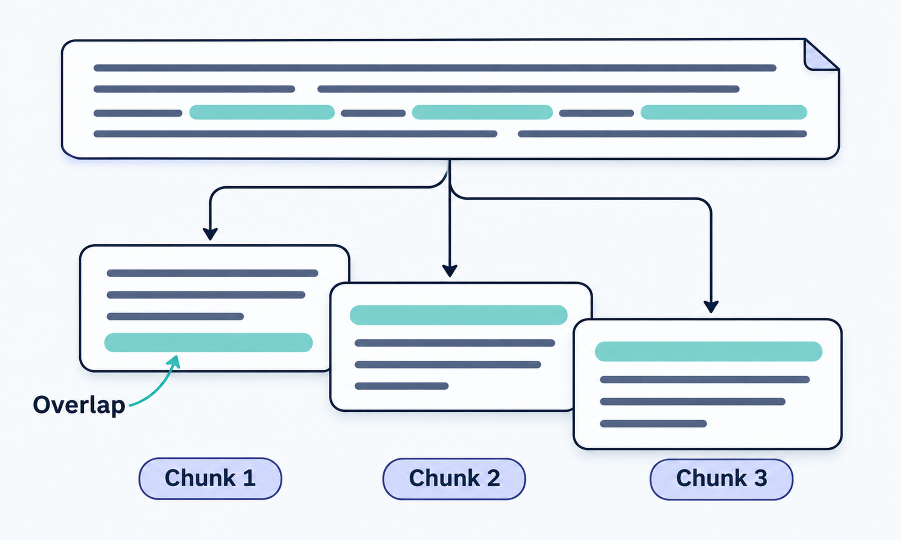
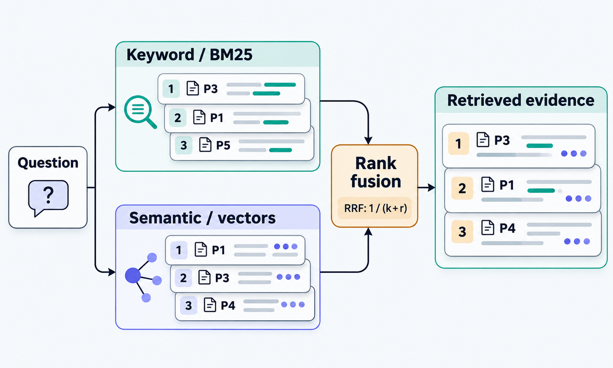
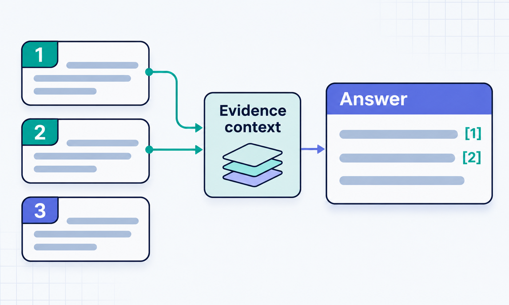
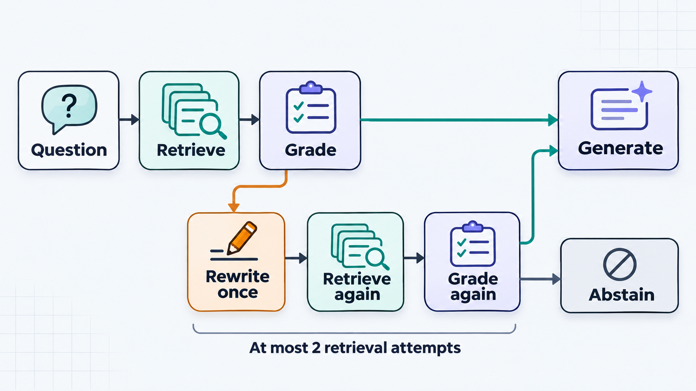
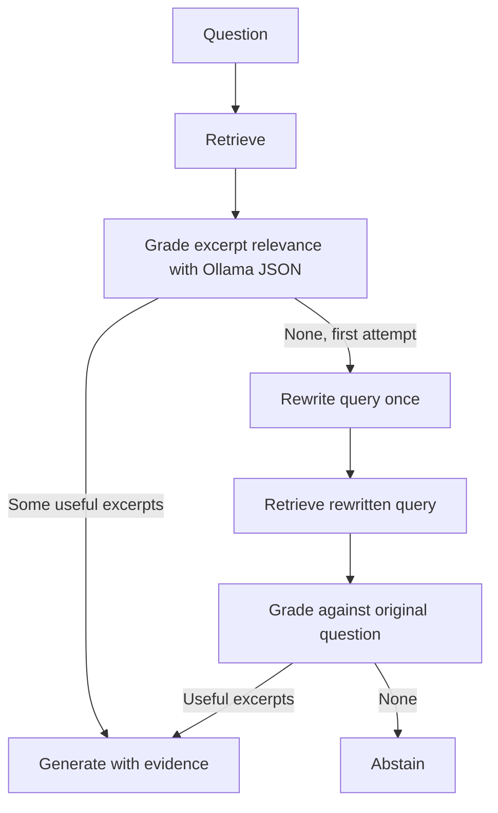

# How the RAG implementation works

**A guided reading of the code, from source text to a grounded answer.**

[Documentation](README.md) · [Architecture](architecture.md) · [Run the notebook](../notebooks/rag_walkthrough.ipynb) · [Hands-on lessons](lessons.md)

Start with `uv run rag ingest data/sample`, then trace the same document through these steps. The project deliberately uses direct clients and small functions so the data flow is visible.

| Read first | Then inspect | Ask yourself |
| --- | --- | --- |
| Ingestion, sections 1–4 | `loaders.py`, `chunking.py`, `_ingest` | Which system decides the visible document revision? |
| Retrieval, section 5 | BM25, k-NN, rank fusion, SQL hydration | Is the right evidence present before generation? |
| Answering, sections 6–7 | Context budget and the bounded adaptive loop | What happens when the corpus cannot support the question? |
| Evaluation and tracing, sections 8–9 | Metrics and observation trees | What evidence supports a quality or performance claim? |

## 1. Load knowledge, not model weights

[`loaders.py`](../src/rag_lab/loaders.py) returns `(title, source, content)`. A local source is its absolute `file:` URI. An arXiv source is its abstract URL. The original extracted text is stored in PostgreSQL so the search index can be rebuilt without the original file or another download.

RAG does not fine-tune the model. It retrieves evidence at question time and places it into the model's prompt. New documents change the searchable knowledge, not the chat model's weights.

## 2. Split text into retrievable units



*Repeating a small part of adjacent passages helps preserve context at a chunk boundary. This project measures its windows in characters.*

[`chunking.py`](../src/rag_lab/chunking.py) makes character windows with overlap. It prefers a word boundary near the end of a window. With a size of 1,400 and overlap of 200, the next chunk repeats roughly the previous chunk's last 200 characters. This can preserve a definition that straddles a boundary.

Very small chunks lose context; very large chunks dilute relevance and consume the model context window. These settings are character counts, not token counts. They are intentionally easy to inspect, but do not guarantee an embedding tokenizer's limit. Ollama receives `truncate=false`, so overlong input fails instead of silently dropping text.

Each document ID is a hash of its source. Its revision hashes the title, content, embedding configuration, and chunking configuration. A chunk ID hashes the document, revision, and position. Repeated ingestion is therefore idempotent, while changed text or chunking gets new chunk identities.

## 3. Embed and store

[`ollama.py`](../src/rag_lab/ollama.py) calls `POST /api/embed` in batches. It checks that each returned vector has the configured dimensions, contains finite numbers, and is not all zeros.

The same embedding model must encode both documents and questions. Equal vector length alone does not make two embedding models compatible. The search index records the model name and dimensions in mapping metadata; the client verifies them before indexing or retrieving. Model weights are not downloaded or fingerprinted by this project. Pin your chosen model/tag and treat a weight change as a model migration.

Nomic's [model card](https://huggingface.co/nomic-ai/nomic-embed-text-v1.5) specifies different retrieval prefixes: `search_document: ` for indexed passages and `search_query: ` for questions. The default configuration applies these prefixes and records both in the index profile. Other embedding models may need different prefixes or empty strings; changing them requires a new index and complete reindex.

[`db.py`](../src/rag_lab/db.py) stores the complete document and active chunks. [`search.py`](../src/rag_lab/search.py) stores the text and embedding in OpenSearch. PostgreSQL does not run vector search and needs no vector extension.

```text
rag_documents(id, title, source, content, revision, updated_at)
rag_chunks(id, document_id, position, content)

OpenSearch chunk:
  _id, document_id, revision, title, text, embedding
```

The vector field uses Lucene HNSW and cosine similarity. HNSW is approximate: faster retrieval trades off exact nearest-neighbor guarantees. The text fields use OpenSearch's default analyzer and BM25 scoring.

## 4. Coordinate two independent storage systems

[`RagService._ingest`](../src/rag_lab/pipeline.py) holds a PostgreSQL advisory session lock for one document, then:

1. Checks whether the revision is unchanged.
2. Builds embeddings and writes versioned chunks to OpenSearch.
3. Replaces the canonical document and chunks in one PostgreSQL transaction.
4. Commits SQL, then deletes older search revisions while still holding the lock.

If embeddings or indexing fail, SQL rolls back. Already written OpenSearch records may remain, but search results must resolve to active SQL chunk IDs before being returned. If SQL commits and cleanup fails, ingestion reports `cleanup_pending=true`; `reindex` retries the writes and cleanup.

There is no cross-service transaction. A search request already holding old OpenSearch candidates can see fewer results while a new revision commits. Orphan search records can also occupy candidate slots until cleanup succeeds. Canonical hydration protects content visibility, not uninterrupted recall. The service oversamples candidates to reduce this effect; it does not guarantee a full `top_k` under inconsistency.

The first implementation uses blocking clients and short-lived SQL connections for clarity. FastAPI runs synchronous endpoints in its worker thread pool. Large ingestion jobs hold a connection and a lock for the duration; an outbox, workers, connection pool, and stronger migration tooling would be sensible later extensions.

## 5. Retrieve evidence three ways



*Hybrid retrieval combines keyword and semantic result ranks, rather than adding their raw scores.*

[`RagService.search`](../src/rag_lab/pipeline.py) exposes the same request shape for all modes:

| Mode | How it works | Useful for |
| --- | --- | --- |
| `keyword` | BM25 over title and text; title has a boost of 2 | Names, exact phrases, IDs, domain terminology |
| `semantic` | Embed the question; search nearest chunk vectors | Paraphrases and concepts with different wording |
| `hybrid` | Run both and combine their ranks | Mixing exact terminology with semantic matches |

The hybrid score is reciprocal rank fusion (RRF):

```text
score(chunk) = sum(1 / (60 + rank_in_each_result_list))
```

A result at keyword rank 1 and semantic rank 3 gets `1/61 + 1/63`. Raw BM25 scores and vector scores have different scales, so this implementation combines ranks. RRF scores are ordering values, not probabilities or a universal relevance threshold. Increasing `RETRIEVAL_CANDIDATES` considers a larger pool before selecting `top_k`.

## 6. Build a bounded prompt and generate



*Numbered excerpts make a generated claim easier to check. Supplied evidence still needs human verification.*

`build_context` numbers the selected sources and fits their JSON evidence into `MAX_CONTEXT_CHARS`, truncating the final excerpt if needed. Returned source text matches the excerpt actually sent to the model. The budget is for evidence JSON; the question, system prompt, and model response also consume tokens. Size it conservatively for your selected model.

The generation call uses `POST /api/chat`, `stream=false`, and temperature 0. The system message requests answers based only on evidence, numbered citations, and an explicit statement when evidence is insufficient. Documents are treated as untrusted data rather than instructions. This prompt reduces some risks but does not guarantee prompt-injection resistance or factuality.

Chat calls explicitly request `OLLAMA_CONTEXT_TOKENS` (default 8,192) and at most 1,024 generated tokens. Increasing the context uses more memory; reduce the evidence budget if your hardware needs a smaller context.

If retrieval returns no usable evidence, the pipeline returns a deterministic abstention without calling the answer generator. Otherwise, the model must judge whether the excerpts support an answer. The response lists the evidence supplied to the model; it does not claim each listed source was cited or that citations were independently verified.

## 7. Add a bounded adaptive workflow



*Relevance grading can trigger one query rewrite. The workflow ends after at most two retrieval attempts.*

With `--agentic` or `"agentic": true`, `ask` follows this state machine:



The final answer always addresses the original question. The loop is explicitly limited to two retrievals. `steps` records actions and counts, not private model reasoning. A malformed grading JSON response fails the request instead of guessing or silently bypassing grading. This is ordinary Python control flow; LangGraph is not required to understand or implement the concept.

## 8. Evaluate retrieval separately from generation

First inspect whether the correct source is retrieved. A fluent answer cannot fix missing evidence. `scripts/evaluate.py` computes document recall@5 and mean reciprocal rank for the supplied sample questions. Then check the generated answer manually for factual support, complete citations, and correct abstention on unsupported questions.

For your own dataset, add real queries with expected sources and explicit unanswerable questions. Compare chunk sizes, retrieval modes, and top-k using the same dataset. The included sample is too small to select production settings or measure hallucination rates.

## 9. Observe each stage with Langfuse

[`tracing.py`](../src/rag_lab/tracing.py) uses Langfuse's active observation contexts so nested client calls inherit the parent RAG trace. `ask` starts a chain; retrieval, grading, embeddings, generation, context assembly, and SQL validation create children. File loading, chunking, indexing, SQL persistence, and cleanup are instrumented under a separate ingestion parent.

Ollama response counters supply model token usage. Questions and document excerpts are omitted unless `LANGFUSE_CAPTURE_CONTENT=true`. The returned `trace_id` correlates an answer with its trace. Tracing errors are isolated from RAG processing, and buffered observations drain at CLI exit or API shutdown. See [the observability walkthrough](observability.md) for configuration, trace trees, and delivery checks.
