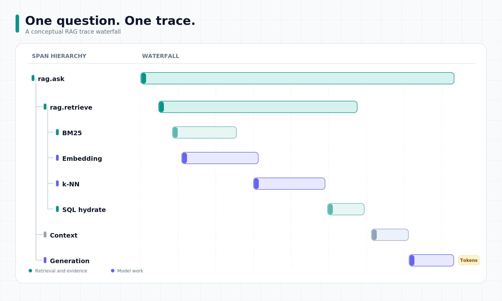

# Trace the complete RAG pipeline with Langfuse

**Understand what ran, how long it took, and which model calls it used.**

[Documentation](README.md) · [Configuration](configuration.md) · [Architecture](architecture.md) · [Notebook](../notebooks/rag_walkthrough.ipynb)

Follow [the README setup](../README.md#enable-langfuse-tracing) to connect your hosted Langfuse project. The SDK is installed with the application; tracing starts only when `LANGFUSE_ENABLED=true` and both project keys are supplied. No local Langfuse deployment, Docker, Airflow, or Redis is required.

## Connect your hosted project

Use project API keys from Langfuse Cloud or your existing compatible server. Add these settings to `.env`, using the URL for your project's region:

```dotenv
LANGFUSE_ENABLED=true
LANGFUSE_PUBLIC_KEY=pk-lf-your-project-key
LANGFUSE_SECRET_KEY=sk-lf-your-project-secret
LANGFUSE_BASE_URL=https://cloud.langfuse.com
LANGFUSE_ENVIRONMENT=development
LANGFUSE_CAPTURE_CONTENT=false
LANGFUSE_TIMEOUT_SECONDS=5
```

Restart the API or notebook kernel after changing configuration. Run `uv run rag doctor`, then ask a question and locate its returned trace ID in Langfuse. The Python SDK is pinned to major version 5, which supports Langfuse Cloud or a hosted server version 4.59.0 or later; see [SDK compatibility](https://langfuse.com/docs/observability/sdk/overview).

## What a question trace contains



*One question becomes a parent trace with nested observations for retrieval, context, and model generation. The illustration shows conceptual timing, not measured execution.*

[`RagService.ask`](../src/rag_lab/pipeline.py) starts `rag.ask` as the parent observation. Langfuse's [active observation context](https://langfuse.com/docs/observability/sdk/instrumentation) makes nested observations its children, including calls made inside the Ollama, OpenSearch, and PostgreSQL clients.

```text
rag.ask                                  chain: one question
  rag.retrieve                           retriever: mode, top-k, final scores and chunk IDs
    opensearch.bm25                       keyword candidates and result count
    ollama.embed.query                   embedding: model, batch size, input tokens
    opensearch.knn                        vector candidates and result count
    postgres.hydrate                      candidate count versus active SQL chunk count
  rag.grade                              evaluator: candidate/relevant excerpt counts (agentic)
    ollama.grade                         generation: grading prompt and token usage
  ollama.rewrite                         generation: one rewrite if grading found no evidence
  rag.retrieve ...                        second attempt, at most once
  rag.grade ...                          second grading pass
  rag.context                            evidence character count and source count
  ollama.generate                        generation: answer model and token usage
```

Only executed steps appear. Keyword mode omits query embeddings and vector search. Plain RAG omits grading and rewriting. Abstention has no answer-generation span; the parent metadata records `outcome=abstain`. Empty grading does not make an unnecessary model call. `trace_id` in the API/CLI answer points to the same trace as its nested spans.

## What an ingestion trace contains

```text
rag.ingest_file                           parent, one local file
  rag.load_file                          TXT/Markdown reading or PDF extraction
  rag.ingest                             document ID, source length, force flag
    rag.chunk                            chunk size, overlap, count
    ollama.embed.document                one observation per embedding batch
    opensearch.index                     chunk count and bulk-write duration
    postgres.persist                     canonical SQL changes and commit
    opensearch.cleanup                   remove inactive search revisions
```

arXiv ingestion starts with `rag.ingest_arxiv` and `rag.load_arxiv`. Reindexing starts with `rag.reindex`. Unchanged documents skip chunking, embeddings, and writes. A failed cleanup is visible as an error on its child span and `cleanup_pending=true` in the result, while successful SQL data remains committed. File ingestion and a later question remain separate operations; this project does not group them into a conversation/session trace.

## What gets sent

[`tracing.py`](../src/rag_lab/tracing.py) centralizes optional tracing and removes `input` and `output` attributes unless content capture is enabled.

| Data | Default | With `LANGFUSE_CAPTURE_CONTENT=true` |
| --- | --- | --- |
| Span hierarchy, start/end timing, observation type | Sent | Sent |
| Model names, reported token usage and model duration | Sent | Sent |
| Chunk/document IDs, retrieval scores, counts and settings | Sent | Sent |
| Error class and error level | Sent | Sent |
| Questions, prompts, evidence, generated text, source paths | Omitted | Sent |
| Database/OpenSearch credentials | Never explicitly attached | Never explicitly attached |
| Embedding vector values | Never attached | Never attached |

Ollama reports input/output token counts through `prompt_eval_count` and `eval_count`; these become Langfuse `usage_details`. Embedding observations use the input count when Ollama reports it. Missing counts remain unknown. The integration does not estimate dollar costs or include a model's private reasoning output.

Exceptions propagate to the application normally, while observations receive a sanitized `ERROR` level and the exception class. Their raw messages and stack traces are not forwarded by this wrapper because they may contain credential-bearing connection strings. Content capture is not a secret scanner: if your document contains credentials, enabling text capture can send that document text to Langfuse.

## Lifecycle and failure handling

Each service shares one tracing client across its pipeline and dependency clients. The SDK uses an isolated OpenTelemetry provider and batches exports in the background. `RagService.close()` calls SDK shutdown to flush buffered observations; both the CLI `finally` block and FastAPI lifespan use it. Avoid force-killing a process immediately after a call if you need its final spans.

`rag doctor` performs the SDK authentication check when tracing is enabled. `/health` only reports configured/initialized tracing state and does not probe Langfuse over the network. Authentication success does not prove OTLP export success. A trace ID identifies a locally created observation, and its presence does not guarantee that the trace is visible on the remote server. Check the Langfuse UI and exporter logs for delivery issues.

Initialization, observation creation/update/close, and shutdown failures are isolated from application results. Enabling tracing with missing keys fails settings validation early. The SDK API is pinned to major version 5; hosted instances must satisfy its [server compatibility requirements](https://langfuse.com/docs/observability/sdk/overview).

## Explore a trace

1. Enable Langfuse with your project's API keys and base URL, then run `uv run rag doctor`.
2. Run `uv run rag ask "Who approves a production restore?" --agentic`.
3. Locate its `trace_id` in Langfuse. Expand `rag.retrieve` and compare BM25, embedding, k-NN, and SQL validation durations.
4. Compare `ollama.grade` and `ollama.generate` token usage. With content capture enabled, inspect the exact model inputs and outputs.
5. Ask an unsupported question and inspect the bounded rewrite/retrieve path and abstention outcome.
6. Run `uv run rag ingest data/sample --force` to inspect the separate ingestion traces.

Automated tests verify nesting, trace IDs, actual SDK token attributes, default text omission, content opt-in, error sanitization, disabled tracing, and telemetry failures using an in-memory exporter. They make no Langfuse network requests and do not replace a live export check with your project.
